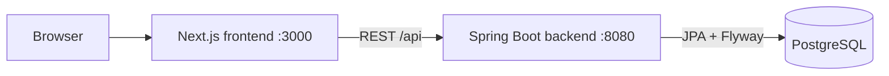
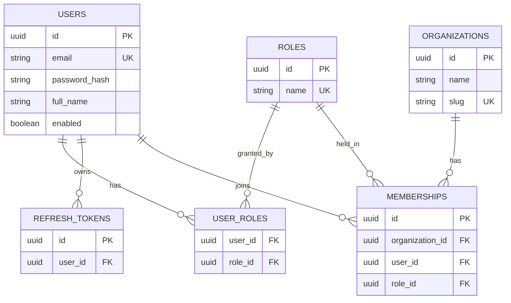

# Connecta

Unified Instagram and Messenger inbox for teams: one inbox for customer conversations, shared product catalog, agent assignment and analytics.

| Part | Stack | Folder |
|---|---|---|
| Frontend | Next.js, TypeScript, Tailwind CSS, pnpm | `frontend/` |
| Backend | Spring Boot (Java 17, Maven), Spring Security, JPA | `backend/` |
| Database | PostgreSQL 17 + Flyway migrations | `docker-compose.yml`, `backend/src/main/resources/db/migration/` |

## Prerequisites
Node.js 24+, pnpm, JDK 17, Docker.

## Local setup

1. **Install root tooling and Git hooks** (do this first, it installs the commit hooks):
   ```bash
   pnpm install
   ```
2. **Environment.** Copy `.env.example` to `.env` (used by docker compose). The backend works without any variables in dev: its `dev` profile has local defaults. The frontend reads `frontend/.env.local` (see `.env.example`).
3. **Start PostgreSQL:**
   ```bash
   docker compose up -d postgres
   ```
4. **Start the backend** (port 8080). Flyway applies pending migrations on startup.
   ```bash
   cd backend
   ./mvnw spring-boot:run        # Windows PowerShell: .\mvnw.cmd spring-boot:run
   ```
   Health: <http://localhost:8080/actuator/health>. API docs (dev only): <http://localhost:8080/swagger-ui/index.html>.
5. **Start the frontend** (port 3000):
   ```bash
   cd frontend
   pnpm install
   pnpm dev
   ```
   The home page shows `Backend: UP` when it can reach the API.

### Tests and checks
```bash
cd backend && ./mvnw test                                  # tests never touch a database
cd frontend && pnpm lint && pnpm test && pnpm build   # build also type-checks
```

### Configuration
Backend profiles: `dev` (default, local defaults) and `prod` (no defaults, every variable is required). Variables are listed in `.env.example`.

## Contributing
Read [AGENTS.md](AGENTS.md) first. In short:
- Work only on issues assigned to you; one issue = one branch = one PR; branch `type/<issue#>-slug`.
- Commits follow Conventional Commits (`type(scope): subject`, scopes `frontend|backend|db|ci|docs`), no `Co-authored-by` or attribution lines. Husky + commitlint enforce this locally.
- The commit author, the `gh` account and the issue assignee must be the same person (checked on commit and push).
- Branches: `main` (protected, releases only), `develop` (protected, integration), feature branches. Feature PRs target `develop` and are squash-merged with 1 approval; `develop` is merged into `main` with a merge commit for a release. CI runs per area (path-filtered).

## Architecture

Backend layers per feature: `controller` (REST controllers + exception handlers) -> `service` -> `repository` -> `domain`, with `dto` records at the edges. Design patterns are listed in [docs/design-patterns.md](docs/design-patterns.md).

## Roles
Roles are `OWNER > ADMIN > AGENT` (a higher role inherits the lower ones). They map to the course roles as `OWNER` = ADMIN, `ADMIN` = SELLER, `AGENT` = BUYER, giving three-tier role-based access. Default is deny: every path needs a valid access token unless it is on the public list in `SecurityConfig`.

## ER diagram

`users` to `roles` is many-to-many through `user_roles`; `users` to `refresh_tokens` is one-to-many. `users` to `organizations` is many-to-many through `memberships`, which also stores the user's role in that organization (one membership per user and organization). More tables arrive with later milestones.

## API endpoints
| Method | Path | Access | Success | Description |
|---|---|---|---|---|
| POST | `/api/auth/register` | public | 201 | Create an `AGENT` account. |
| POST | `/api/auth/login` | public | 200 | Exchange email and password for access and refresh tokens. |
| POST | `/api/auth/refresh` | public | 200 | Rotate the refresh token (single use). |
| POST | `/api/auth/logout` | public | 204 | Revoke the refresh token. |
| GET | `/api/auth/me` | authenticated | 200 | Current user. |

Errors use RFC 9457 problem-detail JSON. Swagger UI is available in the `dev` profile only.

Notes on the auth endpoints:
- `/api/auth/refresh` and `/api/auth/logout` are verb-style paths by convention: they are auth actions, not resources.
- `logout` is public by design. It revokes the refresh token in the request body, so it needs no access token.
- Role rules: `register`, `login`, `refresh` and `logout` are public; `me` needs any authenticated role (`OWNER`, `ADMIN` or `AGENT`).

## Run with Docker
```bash
docker compose up --build
```
Starts PostgreSQL, the backend `app` (<http://localhost:8080>, prod profile) and the `frontend` (<http://localhost:3000>). Configuration comes only from `.env` (copy `.env.example`): `POSTGRES_PASSWORD`, `JWT_SECRET`, `CORS_ALLOWED_ORIGINS` and `NEXT_PUBLIC_API_URL` are required, there are no default secrets. Start order: database, then app (health-checked), then frontend. Data lives in the named volume `postgres-data`.

## Monitoring
Actuator exposes `health` (public), and `info`, `metrics` and `prometheus` (ADMIN token required). Config lives in `ops/`:
`ops/prometheus/prometheus.yml` scrapes `backend:8080/actuator/prometheus`, and `ops/grafana/connecta-dashboard.json` is a
Grafana dashboard (JVM heap, request rate, p95 latency, 5xx rate, DB pool). Run Prometheus and Grafana next to the compose stack
(compose wiring is tracked separately). Put an ADMIN access token in a file mounted at `/etc/prometheus/scrape-token`
(never commit it), add Prometheus as a Grafana data source, then import the dashboard JSON.

## CI/CD
GitHub Actions in `.github/workflows`: `backend.yml` and `frontend.yml` build and test on every PR and on pushes to `develop` and `main` (Maven and pnpm caches on); `commits.yml` runs commitlint. Feature PRs are squash-merged into `develop`; a release PR `develop` -> `main` is merged with a merge commit. `deploy.yml` runs on every push to `main` and builds and tests backend and frontend. Its Render deploy job (a POST to the deploy hook in the repository secret `RENDER_DEPLOY_HOOK_URL`) is commented out for now; uncomment it after a maintainer adds that secret under Settings -> Secrets and variables -> Actions. `compose.yml` validates `docker-compose.yml` with `.env.example` on PRs.
