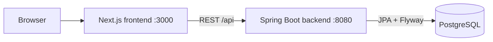
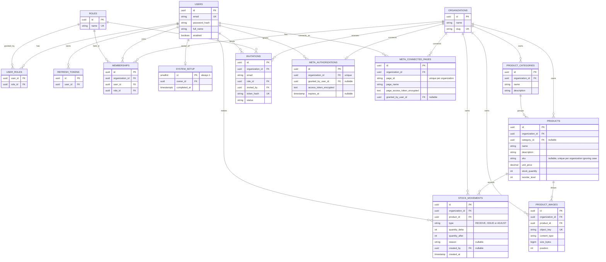

# Connecta

Unified Instagram and Messenger inbox for teams: one inbox for customer conversations, shared product catalog, agent assignment and analytics.

| Part | Stack | Folder |
|---|---|---|
| Frontend | Next.js, TypeScript, Tailwind CSS, pnpm | `frontend/` |
| Backend | Spring Boot (Java 17, Maven), Spring Security, JPA | `backend/` |
| Database | PostgreSQL 17 + Flyway migrations | `docker-compose.yml`, `backend/src/main/resources/db/migration/` |

## Prerequisites
Node.js 24+, pnpm, JDK 17, Docker.

## Local setup

1. **Install root tooling and Git hooks** (do this first, it installs the commit hooks):
   ```bash
   pnpm install
   ```
2. **Environment.** Copy `backend/.env.example` to `backend/.env` (used by docker compose for PostgreSQL and the app). The backend works without any variables in dev: its `dev` profile has local defaults. The frontend reads `frontend/.env.local` (see `frontend/.env.example`).
3. **Start PostgreSQL:**
   ```bash
   docker compose up -d postgres
   ```
4. **Start the backend** (port 8080). Flyway applies pending migrations on startup.
   ```bash
   cd backend
   ./mvnw spring-boot:run        # Windows PowerShell: .\mvnw.cmd spring-boot:run
   ```
   Health: <http://localhost:8080/actuator/health>. API docs (dev only): <http://localhost:8080/swagger-ui/index.html>.
5. **Start the frontend** (port 3000):
   ```bash
   cd frontend
   pnpm install
   pnpm dev
   ```
   The home page shows `Backend: UP` when it can reach the API.

### Tests and checks
```bash
cd backend && ./mvnw test                                  # tests never touch a database
cd frontend && pnpm lint && pnpm test && pnpm build   # build also type-checks
```

### Configuration
Backend profiles: `dev` (default, local defaults) and `prod` (no defaults, every variable is required). Variables are listed in `.env.example`.

## Contributing
Read [AGENTS.md](AGENTS.md) first. In short:
- Work only on issues assigned to you; one issue = one branch = one PR; branch `type/<issue#>-slug`.
- Commits follow Conventional Commits (`type(scope): subject`, scopes `frontend|backend|db|ci|docs`), no `Co-authored-by` or attribution lines. Husky + commitlint enforce this locally.
- The commit author, the `gh` account and the issue assignee must be the same person (checked on commit and push).
- Branches: `main` (protected, releases only), `develop` (protected, integration), feature branches. Feature PRs target `develop` and are squash-merged with 1 approval; `develop` is merged into `main` with a merge commit for a release. CI runs per area (path-filtered).

## Architecture

Backend layers per feature: `controller` (REST controllers + exception handlers) -> `service` -> `repository` -> `domain`, with `dto` records at the edges. Design patterns are listed in [docs/design-patterns.md](docs/design-patterns.md).

## Roles
Roles are `OWNER > ADMIN > AGENT` (a higher role inherits the lower ones). They map to the course roles as `OWNER` = ADMIN, `ADMIN` = SELLER, `AGENT` = BUYER, giving three-tier role-based access. Default is deny: every path needs a valid access token unless it is on the public list in `SecurityConfig`.

| Role | Who | How they get it |
|---|---|---|
| `OWNER` | The system (SaaS) owner. Not tied to any organization; sees all of them through `/api/admin/organizations`. | The first-run setup on a fresh database. Exactly one. |
| `ADMIN` | A customer who runs organizations: creates them, invites people, manages members. | Signs up at `/signup`, or is invited as an admin of an organization. |
| `AGENT` | A team member who works in an organization's inbox. | Invitation only. There is no agent signup. |

Inside an organization only `ADMIN` and `AGENT` exist (the `memberships` role). An organization always keeps at least one `ADMIN`.

### First-run flow
1. On a fresh database `GET /api/setup/status` answers `{"setupRequired": true}` and the web app sends every visitor to `/setup`.
2. `POST /api/setup` creates the `OWNER` once. After that it answers `409` to everyone and the web app sends `/setup` visitors to `/signup`. Signup (`POST /api/auth/register`) is closed (`409`) until the owner exists.
3. Anyone can then sign up; they become an `ADMIN`, create an organization and invite their team.
4. An invitation is emailed over SMTP as a link to `/invitations/accept?token=...`. An invited person without an account chooses a name and password on that page (`POST /api/invitations/accept-new`) and joins with the invited role; someone with an account signs in and accepts (`POST /api/invitations/accept`). The invite response also returns the raw link token once, as a fallback for the admin to copy.

### Invitation email (SMTP)
Set `SMTP_HOST`, `SMTP_PORT`, `SMTP_USER`, `SMTP_PASSWORD`, `SMTP_STARTTLS`, `MAIL_FROM` and `FRONTEND_URL` (see `.env.example`). With a blank `SMTP_HOST` nothing is sent and only a log line says so; the invitation is still created. A mail outage never undoes an invitation. For local work, `docker compose --profile dev up -d mailpit` starts Mailpit (SMTP `localhost:1025`, inbox <http://localhost:8025>), which the `dev` profile already points at.

### Product image storage (any S3-compatible service)
Product images go through `product.service.ProductImageStorage`, with one S3 adapter (`S3ProductImageStorage`) for any S3 API service: AWS S3, Cloudflare R2, MinIO, Backblaze B2, Wasabi, DigitalOcean Spaces. There is no service-specific code path. Set `S3_BUCKET`, `S3_ACCESS_KEY_ID`, `S3_SECRET_ACCESS_KEY` and `S3_PUBLIC_BASE_URL` (see `.env.example`) to use it. `S3_ENDPOINT` is blank for AWS and set for other services, `S3_REGION` defaults to `us-east-1` (R2 uses `auto`), and `S3_PATH_STYLE_ACCESS=true` is needed by MinIO. Local MinIO example (backend run on the host): `S3_ENDPOINT=http://localhost:9000`, `S3_PATH_STYLE_ACCESS=true`, `S3_PUBLIC_BASE_URL=http://localhost:9000/<bucket>`, with the bucket created beforehand. Compose has no MinIO service; it only passes these variables through. Without the four required values, dev keeps images in memory; the `prod` profile refuses to start. Keys are `organizations/{orgId}/products/{productId}/{uuid}.{ext}`, so the client filename is never used. Uploads, listing, streaming and deletes go through `ProductImageController` (see the endpoint table); the content endpoint streams the bytes through the backend, so it works for private buckets and the in-memory store. Limits come from `APP_PRODUCT_IMAGES_MAX_SIZE_BYTES` (default 5 MB) and `APP_PRODUCT_IMAGES_MAX_PER_PRODUCT` (default 8), i.e. `app.product-images.max-size-bytes` and `app.product-images.max-per-product`.

Tenant isolation: an organization's data is reached only through `org.service.TenantAccessService`. A user who is not a member of an organization gets `404` (the same answer as an unknown organization), and a member whose role is too low gets `403`.

## ER diagram

`users` to `roles` is many-to-many through `user_roles`; `users` to `refresh_tokens` is one-to-many. `users` to `organizations` is many-to-many through `memberships`, which also stores the user's role in that organization (one membership per user and organization). `system_setup` holds one row (id 1), written when the first-run setup creates the system `OWNER`. More tables arrive with later milestones.

## API endpoints
| Method | Path | Access | Success | Description |
|---|---|---|---|---|
| GET | `/api/setup/status` | public | 200 | `{"setupRequired": boolean}`: true until the system `OWNER` exists. |
| POST | `/api/setup` | public, once | 201 | Create the system `OWNER`. `409` after the first success. |
| POST | `/api/auth/register` | public | 201 | Create an `ADMIN` account. `409` until the first-run setup is done. |
| POST | `/api/auth/login` | public | 200 | Exchange email and password for access and refresh tokens. |
| POST | `/api/auth/refresh` | public | 200 | Rotate the refresh token (single use). |
| POST | `/api/auth/logout` | public | 204 | Revoke the refresh token. |
| GET | `/api/auth/me` | authenticated | 200 | Current user. |
| GET | `/api/organizations` | authenticated | 200 | Organizations the caller belongs to (`page`, `size` max 100). |
| POST | `/api/organizations` | authenticated | 201 | Create an organization; the caller becomes its `ADMIN`. |
| GET | `/api/organizations/{id}` | member | 200 | One organization. Non-members get `404`. |
| PATCH | `/api/organizations/{id}` | `ADMIN` of it | 200 | Rename it. The slug is fixed. |
| DELETE | `/api/organizations/{id}` | `ADMIN` of it | 204 | Delete it and its memberships. |
| POST | `/api/organizations/{id}/invitations` | `ADMIN` of it | 201 | Invite an email as `ADMIN` or `AGENT`. Emails the link; also returns the raw token once. |
| GET | `/api/organizations/{id}/invitations` | `ADMIN` of it | 200 | List its invitations, newest first (`page`, `size` max 100). Never includes tokens. |
| DELETE | `/api/organizations/{id}/invitations/{invitationId}` | `ADMIN` of it | 204 | Revoke an invitation. An accepted one gets `409`. |
| POST | `/api/invitations/preview` | public (the token is the credential) | 200 | Invited email, organization, role, inviter and `accountExists`. Unknown, expired, revoked or used tokens all answer `404`. |
| POST | `/api/invitations/accept-new` | public (the token is the credential) | 201 | Create the account for the invited email (global role = invited role), join, and sign in. `409` if the email has an account; `422` if expired or revoked. |
| POST | `/api/invitations/accept` | authenticated; email must match the invitation | 200 | Accept with the token. Joins the organization with the invited role. |
| GET | `/api/organizations/{id}/members` | any member of it | 200 | List its members with their role (`page`, `size` max 100). No password data. |
| PATCH | `/api/organizations/{id}/members/{membershipId}` | `ADMIN` of it | 200 | Change a member's role (`ADMIN` or `AGENT`). The last `ADMIN` cannot be demoted (`422`). |
| DELETE | `/api/organizations/{id}/members/{membershipId}` | the member themselves, or `ADMIN` of it | 204 | Remove a member, or leave. The last `ADMIN` cannot leave (`422`). |
| GET | `/api/organizations/{id}/products` | any member | 200 | List products by name (`page`, `size` max 100). Optional filters, combined with AND: `q` (name or SKU contains, ignoring case), `categoryId` (must be this organization's, else `404`), `stockStatus` (`IN_STOCK`, `LOW_STOCK`, `OUT_OF_STOCK`, else `400`). Each product shows `sku`, `unitPrice`, `stockQuantity` (read only), `reorderLevel` and `stockStatus`. |
| POST | `/api/organizations/{id}/products` | `ADMIN` of it | 201 | Create a product. `categoryId` is optional and must be this organization's (`404` otherwise). Duplicate name or SKU (ignoring case) `409`. Optional `sku` (max 64), `unitPrice` (>= 0, 2 decimals, default 0), `reorderLevel` (>= 0, default 0). |
| GET | `/api/organizations/{id}/products/{productId}` | any member | 200 | One product. Another organization's id gets `404`. |
| PUT | `/api/organizations/{id}/products/{productId}` | `ADMIN` of it | 200 | Replace a product, including `sku`, `unitPrice` and `reorderLevel`. A `null` `categoryId` clears its category. `409` on a name or SKU clash. |
| DELETE | `/api/organizations/{id}/products/{productId}` | `ADMIN` of it | 204 | Delete a product and its stored images. |
| POST | `/api/organizations/{id}/products/{productId}/images` | `ADMIN` of it | 201 | Upload an image (multipart field `file`; JPEG, PNG or WebP checked by magic bytes). `415` bad type, `413` over 5 MB, `422` over 8 images. |
| GET | `/api/organizations/{id}/products/{productId}/images` | any member | 200 | List the product's images in display order. |
| GET | `/api/organizations/{id}/products/{productId}/images/{imageId}/content` | any member | 200 | Stream the image bytes (stored `Content-Type`, `inline`, `Cache-Control: private`, `nosniff`). Another organization's id gets `404`. |
| DELETE | `/api/organizations/{id}/products/{productId}/images/{imageId}` | `ADMIN` of it | 204 | Delete an image and its stored object. |
| POST | `/api/organizations/{id}/products/{productId}/stock-movements` | any member | 201 | Record a stock movement: `RECEIVE` or `ISSUE` a `quantity` (>= 1), or `ADJUST` to an absolute level (`quantity` >= 0). Optional `reason` (max 255). The product row is locked while the stock changes. An `ISSUE` beyond stock is `422`; a quantity below its type's minimum is `400`. `Location` points to the movement. |
| GET | `/api/organizations/{id}/products/{productId}/stock-movements` | any member | 200 | One product's movements, newest first (`page`, `size` max 100). |
| GET | `/api/organizations/{id}/stock-movements` | any member | 200 | The organization's movements, newest first. Optional `productId` narrows to one product (must be this organization's, else `404`). |
| GET | `/api/organizations/{id}/stock-movements/{movementId}` | any member | 200 | One movement. Another organization's id gets `404`. |
| GET | `/api/organizations/{id}/inventory/summary` | any member | 200 | `productCount`, `totalUnits`, `stockValue` (stock times unit price, 2 decimals), `lowStockCount` and `outOfStockCount`. |
| GET | `/api/organizations/{id}/product-categories` | any member of it | 200 | List its product categories, by name (`page`, `size` max 100). |
| POST | `/api/organizations/{id}/product-categories` | `ADMIN` of it | 201 | Create a category. `409` if the name is already used in the organization. |
| GET | `/api/organizations/{id}/product-categories/{categoryId}` | any member of it | 200 | One category. Another organization's id gets `404`. |
| PUT | `/api/organizations/{id}/product-categories/{categoryId}` | `ADMIN` of it | 200 | Replace a category's name and description. `409` on a name clash. |
| DELETE | `/api/organizations/{id}/product-categories/{categoryId}` | `ADMIN` of it | 204 | Delete a category. Its products stay, uncategorized. |
| POST | `/api/organizations/{id}/meta/authorization` | `ADMIN` of it | 200 | Start connecting Meta. Returns `{"authorizationUrl"}`, the Facebook login dialog with a signed, 10-minute state. `503` if the Meta app is not configured. |
| GET | `/api/organizations/{id}/meta/authorization` | `ADMIN` of it | 200 | Whether the organization is connected: `{"connected", "connectedAt", "expiresAt"}`. No token is returned. |
| GET | `/api/meta/oauth/callback` | public (the signed state is the check) | 200 | Meta's redirect target. Exchanges the code for a long-lived token and stores it encrypted. `400` for a bad or expired state, `403` if the admin lost the role, `502` if Meta refused. |
| GET | `/api/organizations/{id}/meta/pages` | `ADMIN` of it | 200 | The organization's connected Facebook Pages, by name (`page`, `size` max 100): `pageId`, `name`, `connectedAt`. No tokens. |
| POST | `/api/organizations/{id}/meta/pages` | `ADMIN` of it | 200 | Connect Pages from the Meta grant: body `{"pageIds": [...]}` (1 to 100). Each Page is subscribed to `messages` and `message_echoes`, then stored with its token encrypted. Reconnecting replaces the token. `422` if a Page is not in the grant, `502` if Meta refused. |
| GET | `/api/admin/organizations` | `OWNER` only | 200 | Every organization with its member count (`page`, `size` max 100). |

Errors use RFC 9457 problem-detail JSON. Swagger UI is available in the `dev` profile only.

Notes on the auth endpoints:
- `/api/auth/refresh` and `/api/auth/logout` are verb-style paths by convention: they are auth actions, not resources.
- `logout` is public by design. It revokes the refresh token in the request body, so it needs no access token.
- Role rules: `register`, `login`, `refresh` and `logout` are public; `me` needs any authenticated role (`OWNER`, `ADMIN` or `AGENT`).
- Error bodies for the `409`s: `{"status":409,"title":"Conflict","detail":"Setup is already complete"}`, `"Setup is required before accounts can be created"` and `"An account with this email already exists"`. The shape is always RFC 9457 `status`, `title`, `detail`.

## Run with Docker
```bash
docker compose up --build
```
Add `--profile dev` to also start Mailpit, a local mail catcher for invitation emails (inbox <http://localhost:8025>; set `SMTP_HOST=mailpit` and `SMTP_PORT=1025` in `.env`).

Starts PostgreSQL, the backend `app` (<http://localhost:8080>, prod profile) and the `frontend` (<http://localhost:3000>). Configuration comes only from `.env` (copy `.env.example`): `POSTGRES_PASSWORD`, `JWT_SECRET`, `CORS_ALLOWED_ORIGINS` and `NEXT_PUBLIC_API_URL` are required, there are no default secrets. Invitation email uses `SMTP_*`, `MAIL_FROM` and `FRONTEND_URL` (non-secret defaults in compose; blank `SMTP_HOST` sends nothing). Product images need the `S3_*` variables (see `.env.example`), passed through to the app as-is: `S3_ENDPOINT` (optional, blank for AWS), `S3_REGION`, `S3_BUCKET`, `S3_ACCESS_KEY_ID`, `S3_SECRET_ACCESS_KEY`, `S3_PATH_STYLE_ACCESS` and `S3_PUBLIC_BASE_URL`. The prod profile refuses to start while the bucket, keys or public base URL are blank. The frontend also reads `API_URL` (server-side backend address, set to `http://app:8080` in compose; defaults to `NEXT_PUBLIC_API_URL` outside Docker). Start order: database, then app (health-checked), then frontend. Data lives in the named volume `postgres-data`.

## Monitoring
Actuator exposes `health` (public), and `info`, `metrics` and `prometheus` (ADMIN token required). Config lives in `ops/`:
`ops/prometheus/prometheus.yml` scrapes `backend:8080/actuator/prometheus`, and `ops/grafana/connecta-dashboard.json` is a
Grafana dashboard (JVM heap, request rate, p95 latency, 5xx rate, DB pool). Run Prometheus and Grafana next to the compose stack
(compose wiring is tracked separately). Put an ADMIN access token in a file mounted at `/etc/prometheus/scrape-token`
(never commit it), add Prometheus as a Grafana data source, then import the dashboard JSON.

## CI/CD
GitHub Actions in `.github/workflows`: `backend.yml` and `frontend.yml` build and test on every PR and on pushes to `develop` and `main` (Maven and pnpm caches on); `commits.yml` runs commitlint. Feature PRs are squash-merged into `develop`; a release PR `develop` -> `main` is merged with a merge commit. `deploy.yml` runs on every push to `main` and builds and tests backend and frontend. Its Render deploy job (a POST to the deploy hook in the repository secret `RENDER_DEPLOY_HOOK_URL`) is commented out for now; uncomment it after a maintainer adds that secret under Settings -> Secrets and variables -> Actions. `compose.yml` validates `docker-compose.yml` with `.env.example` on PRs.
