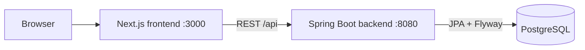

# Connecta

Unified Instagram and Messenger inbox for teams: one inbox for customer conversations, shared product catalog, agent assignment and analytics.

| Part | Stack | Folder |
|---|---|---|
| Frontend | Next.js, TypeScript, Tailwind CSS, pnpm | `frontend/` |
| Backend | Spring Boot (Java 17, Maven), Spring Security, JPA | `backend/` |
| Database | PostgreSQL 17 + Flyway migrations | `docker-compose.yml`, `backend/src/main/resources/db/migration/` |

## Prerequisites
Node.js 24+, pnpm, JDK 17, Docker.

## Local setup

1. **Install root tooling and Git hooks** (do this first, it installs the commit hooks):
   ```bash
   pnpm install
   ```
2. **Environment.** Copy `backend/.env.example` to `backend/.env` (used by docker compose for PostgreSQL and the app). The backend reads `backend/.env` (spring-dotenv) on a local run, and the container environment elsewhere. The frontend reads `frontend/.env.local` (see `frontend/.env.example`).
3. **Start PostgreSQL:**
   ```bash
   docker compose up -d postgres
   ```
4. **Start the backend** (port 8080). Flyway applies pending migrations on startup.
   ```bash
   cd backend
   ./mvnw spring-boot:run        # Windows PowerShell: .\mvnw.cmd spring-boot:run
   ```
   Health: <http://localhost:8080/actuator/health>. API docs (dev only): <http://localhost:8080/swagger-ui/index.html>.
5. **Start the frontend** (port 3000):
   ```bash
   cd frontend
   pnpm install
   pnpm dev
   ```
   The home page shows `Backend: UP` when it can reach the API.

### Tests and checks
```bash
cd backend && ./mvnw test                                  # tests never touch a database
cd frontend && pnpm lint && pnpm test && pnpm build   # build also type-checks
```

### Configuration
Backend configuration is one file, `application.yml`, with no profiles. What differs between environments comes from environment variables (`backend/.env` locally, the container environment in production). A value without a default, such as `DB_URL`, `DB_USER`, `DB_PASSWORD`, `JWT_SECRET`, `META_TOKEN_KEY`, `CORS_ALLOWED_ORIGINS`, `MAIL_FROM` and `FRONTEND_URL`, is required and startup fails without it. Production also sets `S3_REQUIRED=true` and leaves `SWAGGER_ENABLED` unset. Variables are listed in `.env.example`.

| Setting | Variable | Default | Purpose |
|---|---|---|---|
| `app.public-base-url` | `PUBLIC_BASE_URL` | blank | This backend's public address. Attachment links (`/api/files/{id}`) are built from it, and Meta must be able to fetch them, so it cannot be `localhost`: use the deployed URL or a tunnel. Blank: sending an attachment answers `422`. Set it in production. |
| `app.attachments.max-bytes` | `APP_ATTACHMENTS_MAXBYTES` | 8388608 (8 MB) | Largest attachment an agent may send. `spring.servlet.multipart.max-file-size` (8MB) and `max-request-size` (9MB) are aligned with it; raise them together. |
| `app.attachments.mirror-max-bytes` | `APP_ATTACHMENTS_MIRRORMAXBYTES` | 26214400 (25 MB) | Largest incoming file copied from Meta; a bigger download is aborted and the attachment keeps Meta's URL. |
| `app.attachments.mirror-allowed-host-suffixes` | `APP_ATTACHMENTS_MIRRORALLOWEDHOSTSUFFIXES` | `fbcdn.net,cdninstagram.com,fbsbx.com,facebook.com` | The only hosts incoming media is downloaded from (https, default port, every redirect hop re-checked, private and loopback addresses refused). |
| `app.attachments.mirror-max-age` | `APP_ATTACHMENTS_MIRRORMAXAGE` | `3d` | Attachments older than this are no longer retried. |
| `app.attachments.mirror-retry-after` / `mirror-sweep-delay` / `mirror-batch-size` | `APP_ATTACHMENTS_MIRRORRETRYAFTER` / `..._MIRRORSWEEPDELAY` / `..._MIRRORBATCHSIZE` | `15m` / `5m` / 20 | Retry sweep: every `mirror-sweep-delay`, up to `mirror-batch-size` uncopied attachments, each at most once per `mirror-retry-after`. |
| `app.presence.grace-period` | `PRESENCE_GRACE_PERIOD` | `60s` | How long a member's last realtime connection must stay gone before they count as offline and their online interval closes. |
| `app.presence.heartbeat-interval` | `PRESENCE_HEARTBEAT_INTERVAL` | `30s` | How often the open interval of each connected member is stamped (`last_seen_at`); a restart loses at most this much per session. |
| `app.attachments.mirror-timeout` / `mirror-pool-size` / `mirror-queue-capacity` | `APP_ATTACHMENTS_MIRRORTIMEOUT` / `..._MIRRORPOOLSIZE` / `..._MIRRORQUEUECAPACITY` | `20s` / 2 / 100 | Connect and read timeout of each download, and the bounded executor the copies run on (a full queue leaves the copy to the sweep). |

Attachment storage ceiling: Render has no persistent disk, so sent files and copies of incoming media live in PostgreSQL (`stored_files.data`, `bytea`). Each sent file is at most 8 MB and each incoming copy at most 25 MB (`mirror-max-bytes`); a download is held in memory while it is stored, so the copy executor (2 threads) bounds that memory at about 50 MB. The files add up in the database plan's storage (the free Render PostgreSQL has 1 GB) and every read goes through the backend. Nothing expires files yet; deleting an organization deletes its files. Move them to object storage when volume grows.

## Contributing
Read [AGENTS.md](AGENTS.md) first. In short:
- Work only on issues assigned to you; one issue = one branch = one PR; branch `type/<issue#>-slug`.
- Commits follow Conventional Commits (`type(scope): subject`, scopes `frontend|backend|db|ci|docs`), no `Co-authored-by` or attribution lines. Husky + commitlint enforce this locally.
- The commit author, the `gh` account and the issue assignee must be the same person (checked on commit and push).
- Branches: `main` (protected, releases only), `develop` (protected, integration), feature branches. Feature PRs target `develop` and are squash-merged with 1 approval; `develop` is merged into `main` with a merge commit for a release. CI runs per area (path-filtered).

## Architecture

Backend layers per feature: `controller` (REST controllers + exception handlers) -> `service` -> `repository` -> `domain`, with `dto` records at the edges. Design patterns are listed in [docs/design-patterns.md](docs/design-patterns.md).

Assignment: an admin turns a member's `assignable` switch on (`agent_availability`, endpoint `PUT .../members/{membershipId}/assignable`). When a new inbound conversation is stored, `MessageReceivedEvent` reaches `AutoAssignmentListener`, which asks the `RoundRobinAssignmentStrategy` for the assignable, enabled member who waited longest and records the hand-over in `conversation_assignments`. An admin can reassign by hand. Both paths publish `AssignmentChangedEvent`, which the realtime layer pushes to the organization as `conversation.assigned`.

Presence: a member counts as online while at least one realtime WebSocket of theirs is open. `RealtimeSessionRegistry` publishes connection opened and closed events, `PresenceService` opens an `availability_intervals` row on the first connection and closes it after the grace period once the last one drops, and `PresenceHeartbeatJob` stamps `last_seen_at` every 30 s. The availability list shows `online`, and the availability report sums the intervals per UTC day.

## Roles
Roles are `OWNER > ADMIN > AGENT` (a higher role inherits the lower ones). They map to the course roles as `OWNER` = ADMIN, `ADMIN` = SELLER, `AGENT` = BUYER, giving three-tier role-based access. Default is deny: every path needs a valid access token unless it is on the public list in `SecurityConfig`.

| Role | Who | How they get it |
|---|---|---|
| `OWNER` | The system (SaaS) owner. Not tied to any organization; sees all of them through `/api/admin/organizations`. | The first-run setup on a fresh database. Exactly one. |
| `ADMIN` | A customer who runs organizations: creates them, invites people, manages members. | Signs up at `/signup`, or is invited as an admin of an organization. |
| `AGENT` | A team member who works in an organization's inbox. | Invitation only. There is no agent signup. |

Inside an organization only `ADMIN` and `AGENT` exist (the `memberships` role). An organization always keeps at least one `ADMIN`.

### First-run flow
1. On a fresh database `GET /api/setup/status` answers `{"setupRequired": true}` and the web app sends every visitor to `/setup`.
2. `POST /api/setup` creates the `OWNER` once. After that it answers `409` to everyone and the web app sends `/setup` visitors to `/signup`. Signup (`POST /api/auth/register`) is closed (`409`) until the owner exists.
3. Anyone can then sign up; they become an `ADMIN`, create an organization and invite their team.
4. An invitation is emailed over SMTP as a link to `/invitations/accept?token=...`. An invited person without an account chooses a name and password on that page (`POST /api/invitations/accept-new`) and joins with the invited role; someone with an account signs in and accepts (`POST /api/invitations/accept`). The invite response also returns the raw link token once, as a fallback for the admin to copy.

### Invitation email (SMTP)
Set `SMTP_HOST`, `SMTP_PORT`, `SMTP_USER`, `SMTP_PASSWORD`, `SMTP_STARTTLS`, `MAIL_FROM` and `FRONTEND_URL` (see `.env.example`). With a blank `SMTP_HOST` nothing is sent and only a log line says so; the invitation is still created. A mail outage never undoes an invitation. For local work, `docker compose --profile dev up -d mailpit` starts Mailpit (SMTP `localhost:1025`, inbox <http://localhost:8025>), which `.env.example` shows how to point at.

### Product image storage (any S3-compatible service)
Product images go through `product.service.ProductImageStorage`, with one S3 adapter (`S3ProductImageStorage`) for any S3 API service: AWS S3, Cloudflare R2, MinIO, Backblaze B2, Wasabi, DigitalOcean Spaces. There is no service-specific code path. Set `S3_BUCKET`, `S3_ACCESS_KEY_ID`, `S3_SECRET_ACCESS_KEY` and `S3_PUBLIC_BASE_URL` (see `.env.example`) to use it. `S3_ENDPOINT` is blank for AWS and set for other services, `S3_REGION` defaults to `us-east-1` (R2 uses `auto`), and `S3_PATH_STYLE_ACCESS=true` is needed by MinIO. Local MinIO example (backend run on the host): `S3_ENDPOINT=http://localhost:9000`, `S3_PATH_STYLE_ACCESS=true`, `S3_PUBLIC_BASE_URL=http://localhost:9000/<bucket>`, with the bucket created beforehand. Compose has no MinIO service; it only passes these variables through. Without the four required values, images stay in memory; with `S3_REQUIRED=true` (production) the app refuses to start. Keys are `organizations/{orgId}/products/{productId}/{uuid}.{ext}`, so the client filename is never used. Uploads, listing, streaming and deletes go through `ProductImageController` (see the endpoint table); the content endpoint streams the bytes through the backend, so it works for private buckets and the in-memory store. Limits come from `APP_PRODUCT_IMAGES_MAX_SIZE_BYTES` (default 5 MB) and `APP_PRODUCT_IMAGES_MAX_PER_PRODUCT` (default 8), i.e. `app.product-images.max-size-bytes` and `app.product-images.max-per-product`.

Tenant isolation: an organization's data is reached only through `org.service.TenantAccessService`. A user who is not a member of an organization gets `404` (the same answer as an unknown organization), and a member whose role is too low gets `403`.

## ER diagram

```mermaid
erDiagram
    USERS ||--o{ USER_ROLES : has
    ROLES ||--o{ USER_ROLES : granted_by
    USERS ||--o{ REFRESH_TOKENS : owns
    USERS { uuid id PK
        string email UK
        string password_hash
        string full_name
        boolean enabled }
    ROLES { uuid id PK
        string name UK }
    USER_ROLES { uuid user_id FK
        uuid role_id FK }
    REFRESH_TOKENS { uuid id PK
        uuid user_id FK
        uuid session_id "one per device, kept across rotations"
        string user_agent
        string ip
        timestamptz last_used_at }
    ORGANIZATIONS ||--o{ MEMBERSHIPS : has
    USERS ||--o{ MEMBERSHIPS : joins
    ROLES ||--o{ MEMBERSHIPS : held_in
    ORGANIZATIONS { uuid id PK
        string name
        string slug UK }
    MEMBERSHIPS { uuid id PK
        uuid organization_id FK
        uuid user_id FK
        uuid role_id FK }
    USERS ||--o| SYSTEM_SETUP : owner_of
    SYSTEM_SETUP { smallint id PK "always 1"
        uuid owner_id FK
        timestamptz completed_at }
    ORGANIZATIONS ||--o{ PRODUCT_CATEGORIES : owns
    ORGANIZATIONS ||--o{ PRODUCTS : owns
    PRODUCT_CATEGORIES ||--o{ PRODUCTS : groups
    PRODUCT_CATEGORIES { uuid id PK
        uuid organization_id FK
        string name
        string description }
    PRODUCTS { uuid id PK
        uuid organization_id FK
        uuid category_id FK "nullable"
        string name
        string description
        string sku "nullable, unique per organization ignoring case"
        decimal unit_price
        int stock_quantity
        int reorder_level }
    PRODUCTS ||--o{ STOCK_MOVEMENTS : records
    ORGANIZATIONS ||--o{ STOCK_MOVEMENTS : owns
    USERS ||--o{ STOCK_MOVEMENTS : makes
    STOCK_MOVEMENTS { uuid id PK
        uuid organization_id FK
        uuid product_id FK
        string type "RECEIVE, ISSUE or ADJUST"
        int quantity_delta
        int quantity_after
        string reason "nullable"
        uuid created_by FK "nullable"
        timestamp created_at }
    PRODUCTS ||--o{ PRODUCT_IMAGES : shows
    ORGANIZATIONS ||--o{ PRODUCT_IMAGES : owns
    PRODUCT_IMAGES { uuid id PK
        uuid organization_id FK
        uuid product_id FK
        string object_key UK
        string content_type
        bigint size_bytes
        int position }
    ORGANIZATIONS ||--o{ INVITATIONS : receives
    ROLES ||--o{ INVITATIONS : offers
    USERS ||--o{ INVITATIONS : sends
    INVITATIONS { uuid id PK
        uuid organization_id FK
        string email
        uuid role_id FK
        uuid invited_by FK
        string token_hash UK
        string status }
    ORGANIZATIONS ||--o| META_AUTHORIZATIONS : connects
    USERS ||--o{ META_AUTHORIZATIONS : grants
    META_AUTHORIZATIONS { uuid id PK
        uuid organization_id FK "unique"
        uuid granted_by_user_id FK "nullable"
        text access_token_encrypted
        timestamp expires_at "nullable" }
    ORGANIZATIONS ||--o{ META_CONNECTED_PAGES : connects
    USERS ||--o{ META_CONNECTED_PAGES : connects_as
    META_CONNECTED_PAGES { uuid id PK
        uuid organization_id FK
        string page_id "unique per organization"
        string page_name
        text page_access_token_encrypted
        uuid granted_by_user_id FK "nullable"
        timestamp last_webhook_at "nullable" }
    ORGANIZATIONS ||--o{ META_CONNECTED_ACCOUNTS : connects
    USERS ||--o{ META_CONNECTED_ACCOUNTS : grants
    META_CONNECTED_ACCOUNTS { uuid id PK
        uuid organization_id FK
        string platform "INSTAGRAM"
        string external_account_id "unique per organization and platform"
        string username "nullable"
        uuid granted_by_user_id FK "nullable"
        text access_token_encrypted
        timestamp last_webhook_at "nullable" }
    ORGANIZATIONS ||--o{ META_WEBHOOK_EVENTS : receives
    META_WEBHOOK_EVENTS { uuid id PK
        string object "PAGE or INSTAGRAM"
        text payload "raw JSON, as signed by Meta"
        timestamp received_at
        timestamp processed_at "nullable until processed" }
    ORGANIZATIONS ||--o{ META_PROCESSED_MESSAGES : receives
    META_PROCESSED_MESSAGES { uuid id PK
        uuid organization_id FK
        string object "PAGE or INSTAGRAM"
        string external_message_id "unique per organization and object"
        timestamp processed_at }
    ORGANIZATIONS ||--o{ CONVERSATIONS : owns
    META_CONNECTED_PAGES |o--o{ CONVERSATIONS : "receives (SET NULL)"
    META_CONNECTED_ACCOUNTS |o--o{ CONVERSATIONS : "receives (SET NULL)"
    CONVERSATIONS { uuid id PK
        uuid organization_id FK
        string channel "INSTAGRAM or MESSENGER"
        string external_thread_id "unique per organization and channel"
        uuid meta_page_id FK "nullable, the Page of a Messenger conversation"
        uuid instagram_account_id FK "nullable, the account of an Instagram conversation"
        string status "OPEN or CLOSED"
        boolean unread "a customer wrote since a member read it"
        uuid assignee_membership_id FK "nullable, the member handling it"
        timestamp last_message_at "nullable" }
    MEMBERSHIPS |o--o{ CONVERSATIONS : "handles (SET NULL)"
    MEMBERSHIPS ||--o| AGENT_AVAILABILITY : "assignable switch"
    AGENT_AVAILABILITY { uuid id PK
        uuid organization_id FK
        uuid membership_id FK "unique, on delete cascade"
        boolean assignable "admin switch for auto-assignment"
        timestamp last_assigned_at "nullable, round-robin cursor" }
    MEMBERSHIPS ||--o{ AVAILABILITY_INTERVALS : "online stretches"
    AVAILABILITY_INTERVALS { uuid id PK
        uuid organization_id FK
        uuid membership_id FK "on delete cascade, one open row per member"
        timestamp started_at
        timestamp ended_at "nullable while online"
        timestamp last_seen_at "nullable, heartbeat" }
    CONVERSATIONS ||--o{ CONVERSATION_ASSIGNMENTS : "assignment history"
    MEMBERSHIPS |o--o{ CONVERSATION_ASSIGNMENTS : "from / to (SET NULL)"
    USERS |o--o{ CONVERSATION_ASSIGNMENTS : assigns
    CONVERSATION_ASSIGNMENTS { uuid id PK
        uuid organization_id FK
        uuid conversation_id FK "on delete cascade"
        uuid from_membership_id FK "nullable, null on the first assignment"
        uuid to_membership_id FK "nullable, null on an unassignment"
        uuid assigned_by_user_id FK "nullable, null when automatic"
        string source "AUTO_ROUND_ROBIN or MANUAL"
        timestamp created_at }
    ORGANIZATIONS ||--o{ PARTICIPANTS : owns
    PARTICIPANTS { uuid id PK
        uuid organization_id FK
        string channel
        string external_id "unique per organization and channel"
        string display_name "nullable" }
    CONVERSATIONS ||--o{ CONVERSATION_PARTICIPANTS : includes
    PARTICIPANTS ||--o{ CONVERSATION_PARTICIPANTS : joins
    CONVERSATION_PARTICIPANTS { uuid id PK
        uuid organization_id FK
        uuid conversation_id FK
        uuid participant_id FK }
    CONVERSATIONS ||--o{ MESSAGES : contains
    PARTICIPANTS ||--o{ MESSAGES : sends
    USERS ||--o{ MESSAGES : sends_as_agent
    MESSAGES { uuid id PK
        uuid organization_id FK
        uuid conversation_id FK
        string direction "INBOUND or OUTBOUND"
        uuid sender_participant_id FK "inbound only, nullable"
        uuid sent_by_user_id FK "outbound, nullable"
        string external_message_id "unique per organization"
        text body
        timestamp sent_at }
    MESSAGES ||--o{ MESSAGE_ATTACHMENTS : carries
    ORGANIZATIONS ||--o{ MESSAGE_ATTACHMENTS : owns
    MESSAGE_ATTACHMENTS { uuid id PK
        uuid organization_id FK
        uuid message_id FK "on delete cascade"
        string kind "IMAGE, VIDEO, AUDIO, FILE or LINK"
        text url "served URL: our copy once stored, else Meta's"
        text source_url "nullable, the Meta link it came from"
        uuid stored_file_id FK "nullable, our copy, on delete set null"
        timestamp mirror_attempted_at "nullable, last copy attempt"
        string file_name "nullable"
        string content_type "nullable"
        timestamp created_at }
    STORED_FILES |o--o{ MESSAGE_ATTACHMENTS : copy_of
    ORGANIZATIONS ||--o{ STORED_FILES : stores
    STORED_FILES { uuid id PK "random, the public read's only check"
        uuid organization_id FK "on delete cascade"
        string content_type
        string file_name "nullable"
        bigint size_bytes "equals the data length"
        bytea data
        timestamp created_at }
```

`users` to `roles` is many-to-many through `user_roles`; `users` to `refresh_tokens` is one-to-many. `users` to `organizations` is many-to-many through `memberships`, which also stores the user's role in that organization (one membership per user and organization). `system_setup` holds one row (id 1), written when the first-run setup creates the system `OWNER`. A membership has at most one `agent_availability` row (no row means not assignable; its `assignable` flag, set by an admin, decides who receives automatic assignments, online or not); `conversations.assignee_membership_id` is the current assignee and `conversation_assignments` keeps every hand-over, append-only. `availability_intervals` records each stretch a member was online (open while `ended_at` is null, at most one open per membership). It opens with a member's first realtime connection and closes `app.presence.grace-period` (env `PRESENCE_GRACE_PERIOD`, default 60 s) after the last one drops, ended at the drop time; a heartbeat every `app.presence.heartbeat-interval` (env `PRESENCE_HEARTBEAT_INTERVAL`, default 30 s) stamps `last_seen_at` on the open intervals of connected members, and open intervals are closed at `last_seen_at` on startup, so a restart loses at most one heartbeat per session. Presence is held in one instance's memory; it feeds the availability report. More tables arrive with later milestones.

## API endpoints
| Method | Path | Access | Success | Description |
|---|---|---|---|---|
| GET | `/api/setup/status` | public | 200 | `{"setupRequired": boolean}`: true until the system `OWNER` exists. |
| POST | `/api/setup` | public, once | 201 | Create the system `OWNER`. `409` after the first success. |
| POST | `/api/auth/register` | public | 201 | Create an `ADMIN` account. `409` until the first-run setup is done. |
| POST | `/api/auth/login` | public | 200 | Exchange email and password for access and refresh tokens. |
| POST | `/api/auth/refresh` | public | 200 | Rotate the refresh token (single use). |
| POST | `/api/auth/logout` | public | 204 | Revoke the refresh token. |
| GET | `/api/auth/me` | authenticated | 200 | Current user. |
| GET | `/api/auth/sessions` | authenticated | 200 | The caller's active sessions (devices), paginated, with a `current` flag and a `location` ("City, Country") when `GEOIP_DB_PATH` points to a MaxMind GeoLite2 City file (offline lookup; otherwise `null`). |
| DELETE | `/api/auth/sessions/{id}` | authenticated | 204 | Revoke one of the caller's sessions. `404` for an unknown or another user's session. |
| DELETE | `/api/auth/sessions` | authenticated | 204 | Revoke every session except the current one. |
| PUT | `/api/auth/password` | authenticated | 204 | Change the caller's password (`currentPassword`, `newPassword`) and sign out their other devices. `422` for a wrong current password or an unchanged one. |
| GET | `/api/organizations` | authenticated | 200 | Organizations the caller belongs to (`page`, `size` max 100). |
| POST | `/api/organizations` | authenticated | 201 | Create an organization; the caller becomes its `ADMIN`. |
| GET | `/api/organizations/{id}` | member | 200 | One organization. Non-members get `404`. |
| PATCH | `/api/organizations/{id}` | `ADMIN` of it | 200 | Rename it. The slug is fixed. |
| DELETE | `/api/organizations/{id}` | `ADMIN` of it | 204 | Delete it and its memberships. |
| POST | `/api/organizations/{id}/invitations` | `ADMIN` of it | 201 | Invite an email as `ADMIN` or `AGENT`. Emails the link; also returns the raw token once. |
| GET | `/api/organizations/{id}/invitations` | `ADMIN` of it | 200 | List its invitations, newest first (`page`, `size` max 100). Never includes tokens. |
| DELETE | `/api/organizations/{id}/invitations/{invitationId}` | `ADMIN` of it | 204 | Revoke an invitation. An accepted one gets `409`. |
| POST | `/api/invitations/preview` | public (the token is the credential) | 200 | Invited email, organization, role, inviter and `accountExists`. Unknown, expired, revoked or used tokens all answer `404`. |
| POST | `/api/invitations/accept-new` | public (the token is the credential) | 201 | Create the account for the invited email (global role = invited role), join, and sign in. `409` if the email has an account; `422` if expired or revoked. |
| POST | `/api/invitations/accept` | authenticated; email must match the invitation | 200 | Accept with the token. Joins the organization with the invited role. |
| GET | `/api/organizations/{id}/members` | any member of it | 200 | List its members with their role (`page`, `size` max 100). No password data. |
| PATCH | `/api/organizations/{id}/members/{membershipId}` | `ADMIN` of it | 200 | Change a member's role (`ADMIN` or `AGENT`). The last `ADMIN` cannot be demoted (`422`). |
| DELETE | `/api/organizations/{id}/members/{membershipId}` | the member themselves, or `ADMIN` of it | 204 | Remove a member, or leave. The last `ADMIN` cannot leave (`422`). |
| GET | `/api/organizations/{id}/availability` | `ADMIN` of it | 200 | Every member with their availability (`page`, `size` max 100). Items: `membershipId`, `userId`, `email`, `name`, `role`, `assignable`, `updatedAt`, `openConversations` (OPEN conversations assigned to them, one grouped query), `online`. An `AGENT` gets `403`. |
| PUT | `/api/organizations/{id}/members/{membershipId}/assignable` | `ADMIN` of it | 200 | Let a member receive automatic assignments, body `{"assignable":true\|false}`, returns `{membershipId, assignable}`. Creates the availability row on first use. Missing or non-boolean gives `400`; an `AGENT` gets `403`; an unknown or other organization's member gets `404`. Availability list items also carry `assignable`. |
| GET | `/api/organizations/{id}/availability/report?from=&to=` | `ADMIN` of it | 200 | Seconds each member was online per UTC day. `from` and `to` are required inclusive `YYYY-MM-DD` dates, at most 31 days; reversed, over-long, missing or malformed gives `400`. Returns `{from, to, content: [{membershipId, userId, name, role, totalSeconds, days: [{date, availableSeconds}]}], page, size, totalElements}`; `days` has every date zero-filled, members by name (`page`, `size` max 100), open intervals count up to now, future days are 0. An `AGENT` gets `403`. |
| GET | `/api/organizations/{id}/products` | any member | 200 | List products by name (`page`, `size` max 100). Optional filters, combined with AND: `q` (name or SKU contains, ignoring case), `categoryId` (must be this organization's, else `404`), `stockStatus` (`IN_STOCK`, `LOW_STOCK`, `OUT_OF_STOCK`, else `400`). Each product shows `sku`, `unitPrice`, `stockQuantity` (read only), `reorderLevel` and `stockStatus`. |
| POST | `/api/organizations/{id}/products` | `ADMIN` of it | 201 | Create a product. `categoryId` is optional and must be this organization's (`404` otherwise). Duplicate name or SKU (ignoring case) `409`. Optional `sku` (max 64), `unitPrice` (>= 0, 2 decimals, default 0), `reorderLevel` (>= 0, default 0). |
| GET | `/api/organizations/{id}/products/{productId}` | any member | 200 | One product. Another organization's id gets `404`. |
| PUT | `/api/organizations/{id}/products/{productId}` | `ADMIN` of it | 200 | Replace a product, including `sku`, `unitPrice` and `reorderLevel`. A `null` `categoryId` clears its category. `409` on a name or SKU clash. |
| DELETE | `/api/organizations/{id}/products/{productId}` | `ADMIN` of it | 204 | Delete a product and its stored images. |
| POST | `/api/organizations/{id}/products/{productId}/images` | `ADMIN` of it | 201 | Upload an image (multipart field `file`; JPEG, PNG or WebP checked by magic bytes). `415` bad type, `413` over 5 MB, `422` over 8 images. |
| GET | `/api/organizations/{id}/products/{productId}/images` | any member | 200 | List the product's images in display order. |
| GET | `/api/organizations/{id}/products/{productId}/images/{imageId}/content` | any member | 200 | Stream the image bytes (stored `Content-Type`, `inline`, `Cache-Control: private`, `nosniff`). Another organization's id gets `404`. |
| DELETE | `/api/organizations/{id}/products/{productId}/images/{imageId}` | `ADMIN` of it | 204 | Delete an image and its stored object. |
| POST | `/api/organizations/{id}/products/{productId}/stock-movements` | any member | 201 | Record a stock movement: `RECEIVE` or `ISSUE` a `quantity` (>= 1), or `ADJUST` to an absolute level (`quantity` >= 0). Optional `reason` (max 255). The product row is locked while the stock changes. An `ISSUE` beyond stock is `422`; a quantity below its type's minimum is `400`. `Location` points to the movement. |
| GET | `/api/organizations/{id}/products/{productId}/stock-movements` | any member | 200 | One product's movements, newest first (`page`, `size` max 100). |
| GET | `/api/organizations/{id}/conversations` | any member | 200 | The inbox list, most recent message first (`page`, `size` max 100). Both channels in one list. Optional filters, combined with AND: `channel` (`INSTAGRAM`, `MESSENGER`, else `400`), `q` (customer name contains, ignoring case), `status` (`OPEN`, `CLOSED`, else `400`), `assignee` (`me` = held by the caller, `none` = unassigned, else `400`; the Unassigned count is `totalElements` of `assignee=none&size=1`). Each row: `id`, `channel`, `status`, `unread` (a customer wrote since a member last read it), `participantName`, `avatarUrl` (the customer's Meta profile picture, an https link that may expire, or `null`), `lastMessagePreview` (max 140 chars), `lastMessageAt`, `assignee` (`{membershipId, userId, name, online}` or `null`; `online` as in the availability list). Non-member or another organization `404`. |
| GET | `/api/organizations/{id}/stock-movements` | any member | 200 | The organization's movements, newest first. Optional `productId` narrows to one product (must be this organization's, else `404`). |
| GET | `/api/organizations/{id}/stock-movements/{movementId}` | any member | 200 | One movement. Another organization's id gets `404`. |
| GET | `/api/organizations/{id}/inventory/summary` | any member | 200 | `productCount`, `totalUnits`, `stockValue` (stock times unit price, 2 decimals), `lowStockCount` and `outOfStockCount`. |
| GET | `/api/organizations/{id}/conversations/{conversationId}/product-search` | any member of it | 200 | Search the organization's products to share in a conversation. `q` (name or SKU contains), `page`, `size` max 100 (else `400`). Each candidate has `id`, `name`, `sku`, `unitPrice`, `stockStatus` and `imageUrl` (the first image's content path, or `null`). Another organization's conversation gets `404`. |
| GET | `/api/organizations/{id}/product-categories` | any member of it | 200 | List its product categories, by name (`page`, `size` max 100). |
| POST | `/api/organizations/{id}/product-categories` | `ADMIN` of it | 201 | Create a category. `409` if the name is already used in the organization. |
| GET | `/api/organizations/{id}/product-categories/{categoryId}` | any member of it | 200 | One category. Another organization's id gets `404`. |
| PUT | `/api/organizations/{id}/product-categories/{categoryId}` | `ADMIN` of it | 200 | Replace a category's name and description. `409` on a name clash. |
| DELETE | `/api/organizations/{id}/product-categories/{categoryId}` | `ADMIN` of it | 204 | Delete a category. Its products stay, uncategorized. |
| GET | `/api/organizations/{id}/conversations/{conversationId}` | `ADMIN` or `AGENT` of it | 200 | One conversation with participants, status, `unread` and `assignee` (`{membershipId, userId, name}` or null). Another organization id gets `404`. |
| GET | `/api/organizations/{id}/conversations/{conversationId}/messages` | `ADMIN` or `AGENT` of it | 200 | Message history, newest first (`page`, `size` max 100). Each message: `id`, `direction`, `text`, `sentAt`, `senderId`, `senderName`, `attachments` (`[{id, kind, url, fileName, contentType}]`, `kind` is `IMAGE`, `VIDEO`, `AUDIO`, `FILE` or `LINK`; empty array when none). A `LINK` is an Instagram reel or story shared in the thread (webhook types `share`, `ig_reel`, `reel`, `story_mention`; only `image`, `video`, `audio` and `file` are media). A regular post (`ig_post`) is an `IMAGE` named `Shared post` and is copied like a photo (Instagram sends no post permalink, only a signed CDN image). For a `LINK`: `url` is the instagram.com link, `fileName` is `Shared post` or `Story mention`, `contentType` is null, and it is never copied. A message with only attachments has a label such as `[Photo]`, `[Shared post]` or `[Story mention]` as `text`. |
| GET | `/api/organizations/{id}/conversations/{conversationId}/product-shares/preview?productId=` | `ADMIN` or `AGENT` of it | 200 | Preview sharing a catalog product into the conversation: `{productId, text, imageUrl}`. `text` (name, price, SKU, availability, description cut with an ellipsis) always fits the 1000 character reply limit; `imageUrl` is the content path of the product's first image, or null. `400` missing or malformed `productId`; `404` for an unknown or another organization's conversation or product, or a non-member. |
| POST | `/api/organizations/{id}/conversations/{conversationId}/product-shares` | `ADMIN` or `AGENT` of it | 201 | Share a catalog product: body `{productId, text}` (`text` required, at most 1000 characters; the agent may have edited the preview). Sends the product's first image when the channel can deliver one, then the text. Returns `{messages}`: the image message first when it was sent, then the text message; if the image cannot be sent the text still goes and only it is returned. `400` invalid body; `404` unknown or another organization's conversation or product, or a non-member; `422` channel not connected or reply window closed; `502` Meta failed to deliver the text. |
| PATCH | `/api/organizations/{id}/conversations/{conversationId}` | `ADMIN` or `AGENT` of it | 200 | Set the status (`OPEN` or `CLOSED`). `400` on a missing or unknown status. |
| POST | `/api/organizations/{id}/conversations/{conversationId}/assignment` | `ADMIN` of it (OWNER inherits) | 200 | Assign, reassign or unassign: `{membershipId}` (a member's membership id, or `null` to unassign). Returns the current assignee `{conversationId, membershipId, userId, name}` (all null when unassigned). The target may be away (manager override). Writes a `MANUAL` history row. `403` AGENT, `404` conversation or member not in the organization, `422` already assigned to that member (or already unassigned) or the member is disabled. |
| GET | `/api/organizations/{id}/conversations/{conversationId}/assignments` | `ADMIN` of it (OWNER inherits) | 200 | Assignment history, newest first (`page`, `size` max 100). Each row: `id`, `from`, `to` (`{membershipId, userId, name}` or null), `assignedBy` (`{userId, name}` or null for automatic), `source` (`MANUAL` or `AUTO_ROUND_ROBIN`), `createdAt`. `403` AGENT, `404` another organization. |
| PUT | `/api/organizations/{id}/conversations/{conversationId}/read-state` | `ADMIN` or `AGENT` of it | 204 | Mark read `{unread: false}` or unread `{unread: true}` for the whole team. A live customer message marks a conversation unread; a reply from the team marks it read; imported history does neither. `400` missing flag, `404` non-member or another organization. |
| POST | `/api/organizations/{id}/realtime/tickets` | `ADMIN` or `AGENT` of it | 201 | A single-use ticket for the live inbox WebSocket: `{"ticket", "expiresInSeconds"}` (30 s). Non-member or another organization `404`; too many tickets `429` with a `Retry-After` header (seconds). See Realtime below. |
| POST | `/api/organizations/{id}/conversations/{conversationId}/messages` | `ADMIN` or `AGENT` of it | 201 | Send a reply `{text}` (1-1000 chars) through the conversation's channel (Messenger or Instagram) and store it as an outbound message; `Location` header and the message (`id`, `direction`, `text`, `sentAt`, `senderId`, `senderName`, `attachments` always empty) in the body. `400` blank or too long, `404` non-member or another organization, `422` channel not connected, conversation not linked to one of several accounts, or Meta's reply window closed, `502` Meta failed (nothing stored). |
| POST | `/api/organizations/{id}/conversations/{conversationId}/messages/attachments` | `ADMIN` or `AGENT` of it | 201 | Send one file (multipart field `file`) through the conversation's channel. Allowed: JPEG, PNG, GIF images; MP4 video; MP3, M4A/MP4, AAC, WAV audio; PDF (Messenger only). The declared type must be allowed and the file's leading bytes must match it. Up to `app.attachments.max-bytes` (8 MB). The file is kept in `stored_files`, Meta fetches it from `PUBLIC_BASE_URL/api/files/{fileId}`, and the message is stored with a label (`[Photo]`, `[Video]`, `[Voice message]`, `[Attachment]`) as `text` and the attachment (that URL) in `attachments`. `Location` header and the message in the body. `400` file part missing or empty, `404` non-member or another organization, `413` over the limit, `415` type not allowed or content does not match, `422` channel not connected, reply window closed, kind not supported on the channel (a PDF on Instagram) or `PUBLIC_BASE_URL` not set, `502` Meta failed (the stored file is deleted, nothing recorded). |
| POST | `/api/organizations/{id}/meta/authorization` | `ADMIN` of it | 200 | Start connecting Meta. Returns `{"authorizationUrl"}`, the Facebook login dialog with a signed, 10-minute state. `503` if the Meta app is not configured. |
| GET | `/api/organizations/{id}/meta/authorization` | `ADMIN` of it | 200 | Whether the organization is connected: `{"connected", "connectedAt", "expiresAt"}`. No token is returned. |
| GET | `/api/meta/oauth/callback` | public (the signed state is the check) | 302 | Meta's redirect target. Exchanges the code for a long-lived token and stores it encrypted, then redirects the browser to the Integrations page (`?facebook=connected`). A failure redirects back with `metaError` (`denied`, `invalid_state`, `forbidden`, `meta_failed`, `not_configured`). |
| GET | `/api/organizations/{id}/meta/pages` | `ADMIN` of it | 200 | The organization's connected Facebook Pages, by name (`page`, `size` max 100): `pageId`, `name`, `connectedAt`, `lastWebhookAt` (ISO-8601 UTC, null until a webhook arrives for the Page), `historyImportError` (`PERMISSION` or `FETCH` while the last import of past conversations failed, else `null`), `historyImportFailedAt`. No tokens. |
| GET | `/api/organizations/{id}/meta/pages/available` | `ADMIN` of it | 200 | The Pages the Meta grant includes, by name, each with `connected` (true when this organization already connected it). Empty before Facebook is connected. No tokens. `502` if Meta refuses the lookup. |
| POST | `/api/organizations/{id}/meta/pages` | `ADMIN` of it | 200 | Connect Pages from the Meta grant: body `{"pageIds": [...]}` (1 to 100). Each Page is subscribed to `messages` and `message_echoes`, then stored with its token encrypted. Reconnecting replaces the token. `422` if a Page is not in the grant, `502` if Meta refused. |
| POST | `/api/organizations/{id}/meta/instagram` | `ADMIN` of it | 200 | Start connecting an Instagram professional account. Returns `{"authorizationUrl"}` (Instagram Business Login, signed 10-minute state). `503` if Instagram is not configured. |
| GET | `/api/organizations/{id}/meta/instagram` | `ADMIN` of it | 200 | The organization's connected Instagram accounts, paginated (`page`, `size` max 100): `id`, `externalAccountId`, `username`, `lastWebhookAt` (ISO-8601 UTC, null until a webhook arrives for the account), `connectedAt`, `historyImportError`, `historyImportFailedAt` (as for Pages). No token is returned. |
| GET | `/api/meta/instagram/callback` | public (the signed state is the check) | 302 | Instagram's redirect target. Exchanges the code, extends the token and stores the account with its token encrypted, then subscribes the account to `messages` webhooks (`POST /{ig-id}/subscribed_apps`, Bearer token). A failed subscription does not fail the connect; it is logged at WARN with the account id and retried at the next start. `400` bad or expired state, `403` if the admin lost the role, `502` if Instagram refused. |
| GET | `/api/meta/webhooks` | public (the verify token is the check) | 200 | Meta's subscription check. Returns `hub.challenge` as plain text when `hub.mode` is `subscribe` and `hub.verify_token` matches `META_WEBHOOK_VERIFY_TOKEN`; `403` otherwise. |
| GET | `/api/files/{fileId}` | public on purpose (the random UUID is the check) | 200 | A stored file, so Meta can fetch an attachment without a token. `Content-Type` is the stored type, `X-Content-Type-Options: nosniff`, `Content-Disposition: inline` with the encoded file name, `Cache-Control: max-age=31536000, private, immutable`. `404` unknown id. |
| POST | `/api/meta/webhooks` | public (the `X-Hub-Signature-256` is the check) | 200 | Receive a Messenger (`page`) or Instagram event. The signature is verified over the raw body with that product's app secret, then the event is stored unprocessed. `401` bad or missing signature, `400` body not JSON, `503` app secret not set. A refused delivery logs one WARN line (reason class and object only) and counts in `meta.webhook.deliveries{result=rejected}`, an accepted one in `{result=accepted}`. Other Meta products are acknowledged and not stored. Manual step: in the Meta app dashboard the Messenger and Instagram webhook callback URL must be `<APP_BASE_URL>/api/meta/webhooks` (another path such as `/api/webhooks/meta` answers `401`). At startup every connected Instagram account not yet subscribed to `messages` is subscribed (see `docs/meta-webhooks.md`). |
| GET | `/api/admin/organizations` | `OWNER` only | 200 | Every organization with its member count (`page`, `size` max 100). |
| GET | `/api/admin/users` | `OWNER` only | 200 | Every user account (`id`, `email`, `fullName`, `enabled`, `roles`), the caller's own account first, then sorted by email (`page`, `size` max 100). |
| PATCH | `/api/admin/users/{userId}` | `OWNER` only | 200, 404, 422 | Body `{"enabled": boolean}` enables or disables an account. Disabling revokes its refresh tokens and closes its live sessions (`4003`); repeating it is a no-op; an `OWNER` account cannot be disabled (422). |

Errors use RFC 9457 problem-detail JSON. Swagger UI is served only when `SWAGGER_ENABLED=true` (local `.env`).

Notes on the auth endpoints:
- `/api/auth/refresh` and `/api/auth/logout` are verb-style paths by convention: they are auth actions, not resources.
- `logout` is public by design. It revokes the refresh token in the request body, so it needs no access token.
- Role rules: `register`, `login`, `refresh` and `logout` are public; `me` needs any authenticated role (`OWNER`, `ADMIN` or `AGENT`).
- Error bodies for the `409`s: `{"status":409,"title":"Conflict","detail":"Setup is already complete"}`, `"Setup is required before accounts can be created"` and `"An account with this email already exists"`. The shape is always RFC 9457 `status`, `title`, `detail`.

### Realtime (live inbox updates)
`POST /api/organizations/{id}/realtime/tickets` (bearer token) returns a single-use ticket. Open `ws(s)://<api>/ws/inbox?ticket=<ticket>` from the web app origin (`FRONTEND_URL`; other origins get `403`; a missing, used or expired ticket gets `401`). The session is bound to that organization and receives only its events as JSON text frames, for example `{"type":"message.created","conversationId":"...","messageId":"...","channel":"MESSENGER","direction":"INBOUND","newConversation":false,"message":{"id","direction","text","sentAt","senderId","senderName","attachments"}}`. After a customer's name is fetched from Meta the server also pushes `{"type":"participant.updated","conversationId":"..."}` and clients refresh that conversation. When a conversation is assigned, reassigned or unassigned (automatically or by an admin) the server pushes, after commit, `{"type":"conversation.assigned","conversationId":"...","assigneeMembershipId":"..."}` (`null` when unassigned) to that organization only; open lists refresh and the open thread refreshes when the id matches. The client sends the text `ping` every ~30 s and gets `{"type":"pong"}`; a session silent for 90 s is closed (code `4001`), the oldest of a user's more than 5 sessions is closed with `4002`. Tuning: `app.realtime.*` in `application.yml`. When a member is removed from (or leaves) the organization, their sessions for that organization are closed with `4003` (access revoked); their other organizations stay connected. When a user account is disabled, their sessions in every organization are closed with `4003`. A role change closes nothing, because both organization roles (ADMIN, AGENT) have access. When the organization is deleted, all of its sessions are closed with `4003`. A text frame above `app.realtime.max-frame-bytes` (1024) closes the session with `1009`. The ticket endpoint answers `429` (with a `Retry-After` of the rate window in seconds) once a user holds `app.realtime.max-outstanding-tickets` (5) unredeemed tickets or asks for more than `app.realtime.max-tickets-per-window` (20) per `app.realtime.ticket-rate-window` (1 m). The Origin is checked before the ticket is redeemed, so a foreign Origin never burns a ticket.

Close codes: `1009` frame too big, `4001` idle, `4002` too many sessions, `4003` access revoked.

Ops: the ticket travels in the query string (`/ws/inbox?ticket=...`). The application never logs it at the default log levels (do not enable `DEBUG` for `org.springframework.security` or `org.springframework.web` in production: Spring Security's request line includes the query), but a reverse proxy or Render's access logs may record query strings; redact the `ticket` parameter there (this cannot be fixed in code). A ticket is single use and expires in 30 s, which limits the damage of a leaked log line.

Limitation: tickets and sessions are in memory, so more than one backend instance needs a shared ticket store and a broker.

After a history import (below) the server pushes one `{"type":"inbox.refresh"}` frame to the organization instead of one `message.created` per imported message; the web app reloads the list and the open thread once.

### Past conversations are imported automatically (Messenger and Instagram)
There is no endpoint and no button. When a Facebook Page or an Instagram account is connected (or reconnected), the server reads its past conversations from Meta in the background and reconciles them with the inbox through the normal pipeline (`IncomingMessageService`, tenant scoped; a new conversation is linked to the connected account). For the window it reads: a message the organization lacks is inserted; one it has is updated only where Meta now knows more (`MessageReconciler`: a body such as `[Attachment]` becomes `[Photo]` or `[Shared post]`, and attachments the message lacks are added, matched by Meta URL against `url` and `source_url` so a copied attachment is never added twice); an equal one is untouched, and nothing absent from Meta is deleted. Read state, sender, conversation and timestamps never change, and a duplicate webhook delivery never reconciles. The import logs counts only: conversations, messages inserted, updated and unchanged. At startup it also imports every connection whose `history_imported_at` is still empty: connections made before this existed, or an import that failed. A failed import leaves the column empty, so the next start or reconnect retries; what was stored stays and a re-run is idempotent.

Limits (`app.meta.history-import.*` in `application.yml`): `max-conversations` 50, `messages-per-conversation` 50 (the newest), `max-messages` 1000 in total, `page-size` 5 (a bigger page made Instagram answer HTTP 500, Graph code 1, "reduce the amount of data"), `request-timeout` 15s, `worker-threads` 2, `queue-capacity` 100, `max-graph-pages` 200 (loop guard: Graph requests per import), `enabled` true. A hit limit ends the import as done (the account is marked), not failed. Meta permissions: `pages_messaging` (Messenger) and `instagram_manage_messages` (Instagram); without them Meta answers with a permission error, the import is logged and retried at the next start. Timestamps are Meta's `created_time`; attachments are stored with their URL in `message_attachments` and a message with no text gets a label (`[Photo]`, `[Video]`, `[Voice message]`, `[Attachment]`); on Instagram a message with neither text nor attachments is looked up once more (`GET /{message-id}?fields=shares`, counted toward `max-graph-pages`) and each shared post or reel becomes a `LINK` attachment labelled `[Shared post]` (a failed lookup leaves the message `[Attachment]` and never fails the import); customer names come from the Graph participants and never overwrite a name already stored. Single-instance ceiling: the one-import-per-account guard and the job queue are in memory.

View-once photos: an Instagram disappearing photo arrives as the sender's echo (no media) and the receiver's normal photo. Our own show as the note "Disappearing photo. It isn't kept or shown here." With `META_HIDE_VIEW_ONCE=false` (default) a received view-once photo is kept permanently like any photo; with `true` it is recognised by the echo's timestamp (a heuristic) and stored only as that note, never downloaded or copied. Details in `docs/meta-webhooks.md`.


Recent-message sync: the webhook is the fast path and a scheduled sync is the safety net behind it. At startup and every `app.meta.sync.interval` (10m) the newest conversations of each connected Page and Instagram account (`max-conversations` 10, `messages-per-conversation` 10) are read from Meta and any message the organization lacks is stored (idempotent, nothing deleted; one failing account never stops the others). The time of the last good run is kept in `last_synced_at` on `meta_connected_pages` and `meta_connected_accounts`. `app.meta.sync.enabled=false` turns it off. Details in `docs/meta-webhooks.md`.

## Run with Docker
```bash
docker compose up --build
```
Add `--profile dev` to also start Mailpit, a local mail catcher for invitation emails (inbox <http://localhost:8025>; set `SMTP_HOST=mailpit` and `SMTP_PORT=1025` in `.env`).

Starts PostgreSQL, the backend `app` (<http://localhost:8080>, production settings) and the `frontend` (<http://localhost:3000>). Configuration comes only from `.env` (copy `.env.example`): `POSTGRES_PASSWORD`, `JWT_SECRET`, `CORS_ALLOWED_ORIGINS` and `NEXT_PUBLIC_API_URL` are required, there are no default secrets. Invitation email uses `SMTP_*`, `MAIL_FROM` and `FRONTEND_URL` (non-secret defaults in compose; blank `SMTP_HOST` sends nothing). Product images need the `S3_*` variables (see `.env.example`), passed through to the app as-is: `S3_ENDPOINT` (optional, blank for AWS), `S3_REGION`, `S3_BUCKET`, `S3_ACCESS_KEY_ID`, `S3_SECRET_ACCESS_KEY`, `S3_PATH_STYLE_ACCESS` and `S3_PUBLIC_BASE_URL`. Compose sets `S3_REQUIRED=true`, so the app refuses to start while the bucket, keys or public base URL are blank. The frontend also reads `API_URL` (server-side backend address, set to `http://app:8080` in compose; defaults to `NEXT_PUBLIC_API_URL` outside Docker). Start order: database, then app (health-checked), then frontend. Data lives in the named volume `postgres-data`. Session locations on a local run: `pnpm geoip` once (downloads to `backend/geoip/`, git-ignored), then restart the backend. Session locations in compose: compose downloads the free DB-IP City Lite database into the app image at build time (`GEOIP_DB_URL` blank is that default, a direct link to your own `.mmdb` or `.mmdb.gz` replaces it, `none` skips it; DB-IP data is CC BY 4.0, credit [DB-IP.com](https://db-ip.com)) and points `GEOIP_DB_PATH` at it; if the download fails the app still starts and sessions show no location. On Render, set `GEOIP_DB_URL` as an environment variable (it is passed to the Docker build) to your own download link or leave it blank for DB-IP.

## Monitoring
Actuator exposes `health` (public), and `info`, `metrics` and `prometheus` (ADMIN token required). Config lives in `ops/`:
`ops/prometheus/prometheus.yml` scrapes `backend:8080/actuator/prometheus`, and `ops/grafana/connecta-dashboard.json` is a
Grafana dashboard (JVM heap, request rate, p95 latency, 5xx rate, DB pool). Run Prometheus and Grafana next to the compose stack
(compose wiring is tracked separately). Put an ADMIN access token in a file mounted at `/etc/prometheus/scrape-token`
(never commit it), add Prometheus as a Grafana data source, then import the dashboard JSON.

## CI/CD
GitHub Actions in `.github/workflows`: `backend.yml` and `frontend.yml` build and test on every PR and on pushes to `develop` and `main` (Maven and pnpm caches on); `commits.yml` runs commitlint. Feature PRs are squash-merged into `develop`; a release PR `develop` -> `main` is merged with a merge commit. `deploy.yml` runs on every push to `main` and builds and tests backend and frontend. Its Render deploy job (a POST to the deploy hook in the repository secret `RENDER_DEPLOY_HOOK_URL`) is commented out for now; uncomment it after a maintainer adds that secret under Settings -> Secrets and variables -> Actions. `compose.yml` validates `docker-compose.yml` with `.env.example` on PRs.
